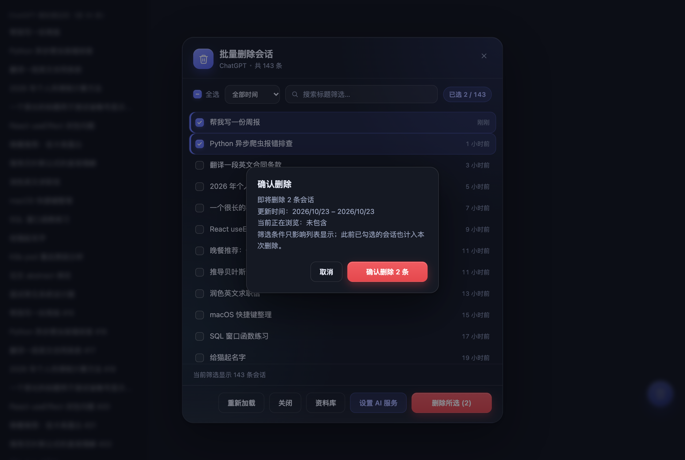
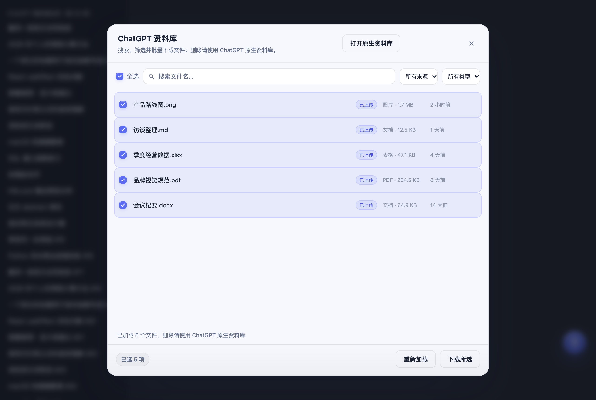

# Clear Chats（AI 聊天批量删除）

网页版 AI 聊天的左侧会话只能一条条删。**Clear Chats** 给 ChatGPT、Claude、Grok、Gemini、Kimi、Qwen、DeepSeek、智谱清言、腾讯元宝、豆包加上同一个悬浮按钮：点开后弹窗列出会话，可搜索、全选、多选，一键批量删除。**删除可以放到后台跑**，深浅色主题自动适配。

## 支持站点

| 站点 | 列表来源 | 删除方式 |
| --- | --- | --- |
| ChatGPT（chatgpt.com、chat.openai.com） | 会话接口，全量 | 原生批量删除 → 单条删除 → 归档隐藏（多级回退） |
| Claude（claude.ai） | 会话接口全量 + 侧边栏补充 Cowork 任务 | 原生 `delete_many`（每批 20 条），失败逐条回退 |
| Grok（grok.com） | 会话接口，全量 | 原生软删除接口 |
| Gemini（gemini.google.com） | 侧边栏可见项 | 原生 DeleteConversation RPC，逐条 |
| Kimi（www.kimi.com） | 侧边栏可见项 | 原生 DeleteChat 接口，逐条 |
| Qwen（chat.qwen.ai） | 会话接口全量（含置顶） | 原生删除接口，逐条 |
| DeepSeek（chat.deepseek.com） | 会话接口全量 + 侧边栏补充置顶 | 原生批量删除（每批 20 条），失败回退单条 |
| 智谱清言（chatglm.cn） | 会话接口，全量 | 原生删除接口，逐条（带 `x-sign` 签名） |
| 腾讯元宝（yuanbao.tencent.com） | 会话接口，全量 | 原生删除接口，逐条 |
| 豆包（www.doubao.com） | IM 会话接口，全量 | 原生批量删除接口（IM 协议，逐条） |

> Gemini 和 Kimi 没有可稳定调用的会话列表接口，只能操作侧边栏里已经加载出来的会话；想删更早的会话，先在侧边栏滚动加载出来，再打开弹窗。DeepSeek 的置顶会话从侧边栏补充，其余站点会一次拉全量（上限 1000 条）。智谱清言、腾讯元宝、豆包都需要登录态。

AI 标题建议和资料库辅助面板目前支持 ChatGPT。资料库面板可搜索、筛选和批量下载；批量删除使用 ChatGPT 自带功能。其他站点的会话管理不受影响。

## 截图

| 会话列表 | 删除前确认范围 |
| --- | --- |
|  |  |
| 后台删除进度 | 资料库辅助管理 |
|  |  |

> 截图使用本地模拟数据，不包含真实会话或文件。其他站点的会话管理界面相同，标题旁会显示当前站点名。

## 安装（Chrome / Edge，约 1 分钟）

1. 打开扩展管理页：地址栏输入 `chrome://extensions/`（Edge 为 `edge://extensions/`）
2. 打开「开发者模式」开关（Chrome 在右上角，Edge 在左侧）
3. 点击「加载已解压的扩展程序」，选择本文件夹（clear-chats）
4. 打开或刷新任一支持站点的页面，右下角出现靛蓝色垃圾桶按钮即成功

> 扩展未上架商店，只能以"开发者模式加载"方式使用；Chrome 偶尔弹出的"开发者模式扩展"提醒选择保留即可。

## 使用

1. 点右下角按钮（鼠标点击或 Tab 聚焦后 Enter 均可；按住可拖动到顺手的位置，位置会记住）
   - 也可以点浏览器工具栏的扩展图标：弹窗会显示当前站点是否已连接，点「打开删除面板」直接打开
2. 弹窗自动加载会话列表：按最近更新排序、带相对时间，正在浏览的会话有「当前」标记
3. 顶部可按标题搜索，也可按更新时间筛选 24 小时、7 天、30 天、90 天或 1 年以前的会话；点「全选」只会选中当前筛选结果（半选状态显示减号）
4. 点红色「删除所选」，在预览中核对数量、更新时间范围和当前会话后确认；删除中按钮变为「中止删除」，可随时停下
5. **删除开始后可以直接把弹窗收掉**（Esc / × / 点遮罩空白处都行）：
   - 删除在后台继续，右下角悬浮按钮出现环形进度，旁边小气泡显示「删除中 3/17」
   - 完成后气泡变成「已删除 17 个 ✓」，几秒后自动消失
   - 随时再点按钮可重新打开弹窗看实时进度，也能点「中止删除」停下
6. 重新打开弹窗时会自动刷新为最新列表；删除成功的会话会立刻从侧边栏消失或隐藏。删除失败或中止时，未完成项会保留勾选，方便重试
7. 在 ChatGPT 勾选需要整理的会话，点「AI 生成标题」并确认发送近期内容；检查和编辑建议后，再点「更新原标题」写回 ChatGPT。生成或更新失败的条目可重试
8. 在 ChatGPT `/library` 页面点击右下角悬浮按钮，或从会话面板点「资料库」，打开资料库辅助面板。支持搜索、筛选和批量下载；批量删除请使用 ChatGPT 原生资料库。

> 注意：**切到别的标签页**没问题（Chrome 会节流后台标签的定时器，速度可能慢一些，但会跑完）；**关掉或刷新当前页面**会中断删除（前端脚本随之卸载），请保留该标签页。

## 工作原理与隐私

- 扩展没有自建服务器或统计。会话列表和删除请求只访问当前 AI 网站；AI 标题功能默认关闭，只有配置服务、手动选择会话并确认后，才会将所选会话最近最多 8 条文字消息发送给配置的 AI 服务
- 资料库列表和下载直接调用 ChatGPT 当前登录态下的网页接口；文件内容不会发送给扩展配置的 AI 服务。资料库内部接口没有稳定的公开契约，ChatGPT 改版后可能需要适配。删除由 ChatGPT 原生资料库处理。
- AI 服务地址权限由用户在设置页保存配置时单独授权；API Key 保存在浏览器扩展本地存储中。使用云端服务时，消息会按该服务的隐私政策处理；也可配置本机兼容服务
- 会话列表和删除都调用**当前网站自己**的同源接口（与网页版相同），使用你当前的登录态
- 各站删除方式不同，但都是站点原生行为：
  - ChatGPT 优先真删除，接口不可用时回退到隐藏/归档（`PATCH /backend-api/conversation/{id}`），效果同样是会话从列表消失，此时完成提示会说明
  - Grok 走软删除接口，会话同样从列表消失
  - Claude / Gemini / Kimi / Qwen / DeepSeek / 智谱清言 / 腾讯元宝 / 豆包 走各自的删除接口
  - 智谱清言删除时按网页前端算法生成 `x-sign`；豆包走网页自己的 IM 删除协议（`/im/conversation/batch_del_user_conv`，cmd 4171），不需要额外签名
- 界面用 Shadow DOM（open 模式，便于控制台排查）+ adoptedStyleSheets 隔离，不改动网站本身的样式与逻辑
- 主题跟随各站点自己的深浅色设置（`<html>` 的 class、`data-theme` 等标记，兜底按实际背景色和系统偏好判断）
- 站点差异集中在 `sites/` 目录：每个站点一个文件，只负责「列表 + 删除」两件事，界面与进度逻辑在 `content.js` 里复用

## 常见问题

- **按钮没出现？** 刷新当前站点页面；到扩展管理页确认插件已启用；确认网址在支持列表中。
- **提示"加载失败"？** 确认已登录；稍后点弹窗里的「重新加载」。
- **只列出几条会话？** Gemini / Kimi 读的是侧边栏已渲染的条目，先在侧边栏展开或滚动加载，再点「重新加载」。
- **删完侧边栏还显示？** 页面缓存，刷新页面即可，会话实际已删除；除 ChatGPT 直接移除节点外，其他站点都会自动把删掉的行隐藏。
- **能删当前正在看的会话吗？** 能。页面暂时停留在原聊天，刷新后不再可访问。
- **关掉弹窗后没反应？** 看右下角气泡是否还在转；若显示「已中止」说明点过「中止删除」。
- **以后失效了？** 网站改版可能变更内部接口（未公开 API，无稳定性保证）。届时修改 `sites/` 下对应站点的文件即可；ChatGPT 的删除回退顺序在 `sites/chatgpt.js`。
- **Firefox？** 本清单面向 Chrome / Edge（Manifest V3）。Firefox 也可加载，但更建议改用 Tampermonkey 版本。

## 本地回归测试

`test/` 目录内置本地模拟测试（需要 Node；浏览器流程还需要本机安装 Chrome）：

```bash
cd test
npm install
npm test
```

- `shot.js` 模拟 ChatGPT 会话及资料库，覆盖搜索、确认删除、后台进度、主题、资料库筛选/批量下载，共 31 项断言；截图输出到 `test/shots/`
- `multi-site.js` 模拟 Claude、Grok、Gemini、Kimi、Qwen、DeepSeek、智谱清言、腾讯元宝和豆包，共 26 项断言
- `adapters-unit.cjs` 不启动浏览器，检查分页、请求体、错误处理和 URL 解析，共 43 项断言
- `extension-load.cjs` 使用 Chrome 加载扩展并检查工具栏弹窗和站点注入，共 6 项断言

## 文件说明

- `manifest.json` —— 扩展配置（Manifest V3；本地存储；在用户点击时通过 `activeTab` 和 `scripting` 连接当前 ChatGPT 页面；AI 地址访问权限按需申请）
- `popup.html`、`popup.css`、`popup.js` —— 工具栏弹窗：检测当前站点、一键打开删除面板、GitHub 仓库入口，磨砂玻璃 + 靛蓝渐变
- `content.js` —— 通用界面与流程：悬浮按钮、弹窗、搜索/全选、删除确认、后台进度与中止删除
- `background.js`、`options.html`、`options.js`、`options.css` —— 可选 AI 服务设置与标题生成请求代理；标题只在审核确认后更新
- `sites/shared.js` —— 站点注册、同源请求封装、DOM 列表扫描、删除后隐藏行、主题检测
- `sites/chatgpt.js`、`sites/claude.js`、`sites/grok.js`、`sites/gemini.js`、`sites/kimi.js`、`sites/qwen.js`、`sites/deepseek.js`、`sites/chatglm.js`、`sites/yuanbao.js`、`sites/doubao.js` —— 各站点的会话适配器；ChatGPT 还负责标题生成所需的读取、标题更新和资料库列表/下载
- `content.css` —— 删除成功后隐藏侧边栏对应行的样式
- `icons/` —— 16/32/48/128 四档扩展图标，`icon.svg` 为矢量源文件
- `test/` —— 本地回归测试（harness 模拟页 + 多站点模拟 + 无头浏览器截图断言脚本）
