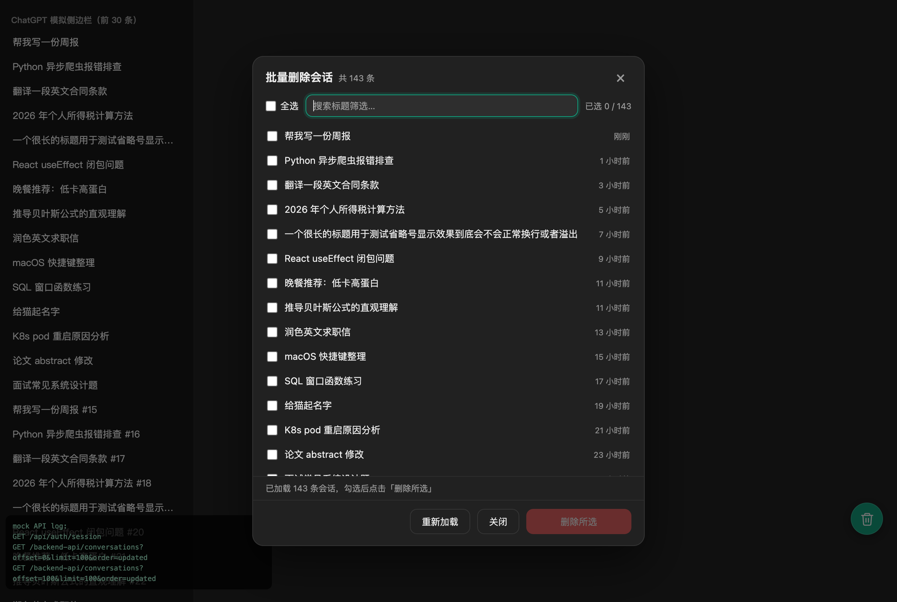
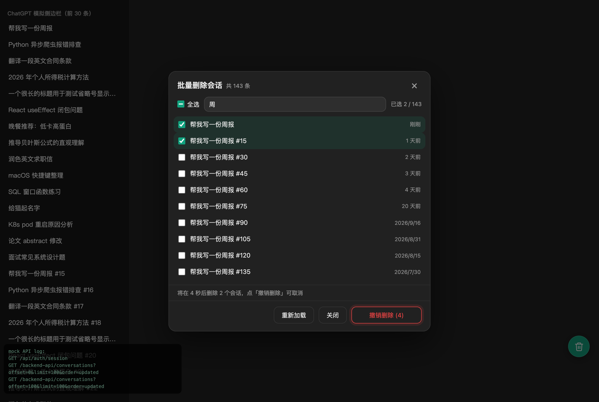
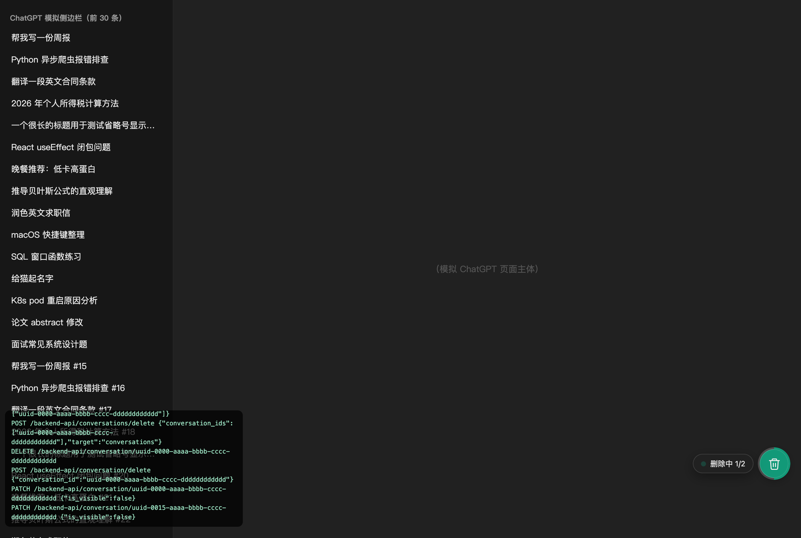

# ChatGPT 批量删除会话（浏览器扩展）

网页版 ChatGPT 左侧会话只能一条条删。这个扩展在页面右下角加一个悬浮按钮，点开后弹窗列出全部会话，可搜索、全选、多选，一键批量删除。**删除可以收到后台跑**，深浅色主题自动适配。

## 截图

| 会话列表（搜索 / 全选 / 相对时间） | 删除前 5 秒可撤销 | 收起弹窗后台删除 |
| --- | --- | --- |
|  |  |  |

## 安装（Chrome / Edge，约 1 分钟）

1. 打开扩展管理页：地址栏输入 `chrome://extensions/`（Edge 为 `edge://extensions/`）
2. 打开「开发者模式」开关（Chrome 在右上角，Edge 在左侧）
3. 点击「加载已解压的扩展程序」，选择本文件夹（chatgpt-batch-delete）
4. 打开或刷新 https://chatgpt.com ，右下角出现绿色垃圾桶按钮即成功

> 扩展未上架商店，只能以"开发者模式加载"方式使用；Chrome 偶尔弹出的"开发者模式扩展"提醒选择保留即可。

## 使用

1. 点右下角按钮（鼠标点击或 Tab 聚焦后 Enter 均可；按住可拖动到顺手的位置，位置会记住）
2. 弹窗自动加载全部会话：按最近更新排序、带相对时间，正在浏览的会话有「当前」标记
3. 顶部搜索框按标题筛选；勾选要删的会话，或点「全选」选中当前筛选结果（半选状态显示减号）
4. 点红色「删除所选」——**只需点一次**：按钮立刻变成「撤销删除 (5)」并开始倒计时，状态栏同步提示「将在 5 秒后删除 N 个会话」
   - 5 秒内再点一下 = 撤销，什么都不会删
   - 不动它，倒计时结束自动开始删除
   - 倒计时期间改勾选 / 搜索 / 收起弹窗，也会自动取消
   - 嫌 5 秒太长或太短：改 `content.js` 顶部的 `UNDO_SECONDS` 常量即可
5. **删除开始后可以直接把弹窗收掉**（Esc / × / 点遮罩空白处都行）：
   - 删除在后台继续，右下角悬浮按钮出现环形进度，旁边小气泡显示「删除中 3/17」
   - 完成后气泡变成「已删除 17 个 ✓」，几秒后自动消失
   - 随时再点按钮可重新打开弹窗看实时进度，也能点「中止删除」停下
6. 重新打开弹窗时会自动刷新为最新列表

> 注意：**切到别的标签页**没问题（Chrome 会节流后台标签的定时器，速度可能慢一些，但会跑完）；**关掉或刷新 ChatGPT 页面**会中断删除（前端脚本随之卸载），请保留该标签页。

## 工作原理与隐私

- **纯本地运行**：没有服务器、没有统计、不上传任何数据；manifest 未申请任何权限
- 会话列表和删除都调用 chatgpt.com 自身的同源接口（与网页版相同），使用你当前的登录态
- 删除优先走真删除接口；若不可用，自动回退到隐藏/归档接口（`PATCH /backend-api/conversation/{id}`），效果同样是会话从列表消失——此时完成提示会说明，彻底清理可到 设置 → 数据控制
- 界面用 Shadow DOM（open 模式，便于控制台排查）+ adoptedStyleSheets 隔离，不改动 ChatGPT 页面本身的样式与逻辑
- 主题跟随 ChatGPT 的深浅色设置（`<html>` 的 dark/light class，兜底读系统偏好）

## 常见问题

- **按钮没出现？** 刷新 chatgpt.com；到扩展管理页确认插件已启用。
- **提示"加载失败"？** 确认已登录 ChatGPT；稍后点弹窗里的「重新加载」。
- **删完侧边栏还显示？** 页面缓存，刷新页面即可，会话实际已删除。
- **能删当前正在看的会话吗？** 能。页面暂时停留在原聊天，刷新后不再可访问。
- **关掉弹窗后没反应？** 看右下角气泡是否还在转；若显示「已中止」说明点过「中止删除」。
- **以后失效了？** ChatGPT 改版可能变更内部接口（未公开 API，无稳定性保证）。届时修改 `content.js` 里的「删除方法表 DELETE_METHODS」即可。
- **Firefox？** 本清单面向 Chrome / Edge（Manifest V3）。Firefox 也可加载，但更建议改用 Tampermonkey 版本。

## 本地回归测试

`test/` 目录内置一套无头 Chrome 测试环境（需本机装有 Chrome 和 Node）：

```bash
cd test && npm install && node shot.js
```

脚本会 mock 掉 ChatGPT 的内部接口（模拟批量删除接口 404、隐藏接口可用等场景），自动跑完「加载 → 搜索 → 勾选 → 5 秒撤销窗口 → 自动执行 → 收起弹窗后台删除 → 主题切换」全流程，输出 31 项断言结果，并把每个阶段的界面截图存到 `test/shots/`。

## 文件说明

- `manifest.json` —— 扩展配置（Manifest V3，零权限）
- `content.js` —— 全部逻辑：界面 + 列表加载 + 删除（多级回退、限速重试、后台进度）
- `icons/` —— 16/48/128 三档扩展图标
- `test/` —— 本地回归测试（harness 模拟页 + 无头浏览器截图断言脚本）
